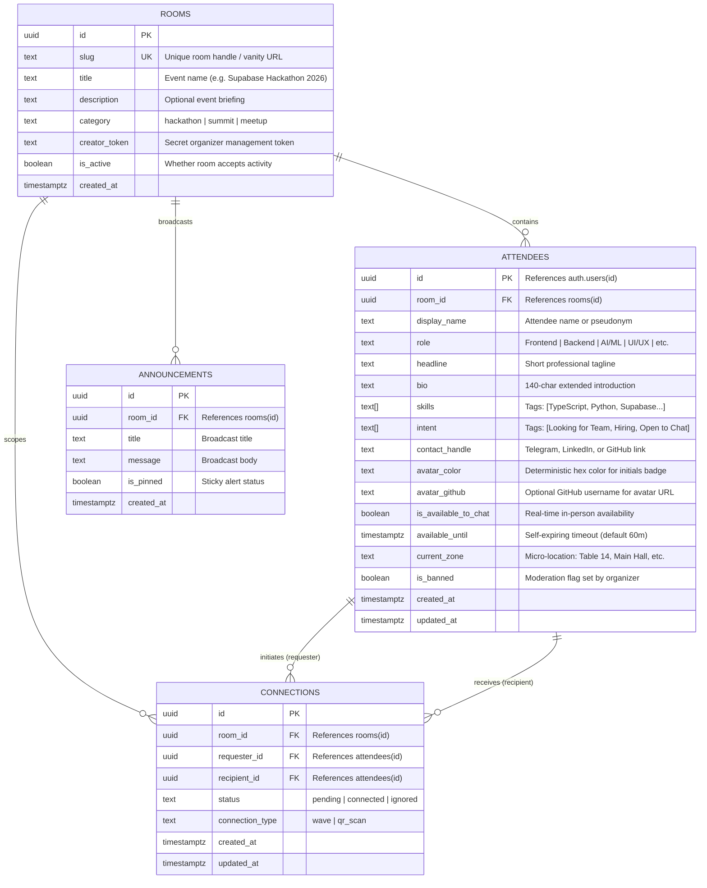
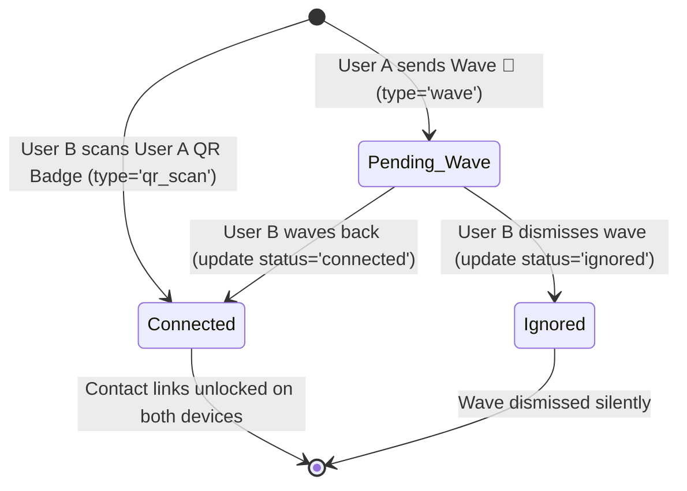

# Data Model: Tech Event Social & Networking Rooms

**Feature**: Tech Event Social & Networking Rooms  
**Storage**: Supabase Cloud PostgreSQL 15+  
**Security**: Default-deny PostgreSQL Row Level Security (RLS) policies  

---

## 1. Entity-Relationship Overview

---

## 2. Table Specifications & Validation Rules

### 2.1 `public.rooms`

Represents an event hall or hackathon space created on the platform.

| Column | Type | Constraints | Description |
| :--- | :--- | :--- | :--- |
| `id` | `uuid` | `PRIMARY KEY DEFAULT gen_random_uuid()` | Immutable internal identifier. |
| `slug` | `text` | `NOT NULL UNIQUE` | URL-safe room slug (e.g., `hack-summit-2026`). Regex: `^[a-z0-9-_]{3,50}$`. |
| `title` | `text` | `NOT NULL CHECK (char_length(title) BETWEEN 3 AND 100)` | Visible event title. |
| `description` | `text` | `CHECK (description IS NULL OR char_length(description) <= 500)` | Optional event description. |
| `category` | `text` | `NOT NULL CHECK (category IN ('hackathon', 'summit', 'meetup'))` | Event format determining matching heuristics. |
| `creator_token` | `text` | `NOT NULL` | Secret hash/token stored client-side by organizer to manage the room. |
| `is_active` | `boolean` | `NOT NULL DEFAULT true` | Active room flag. |
| `created_at` | `timestamptz` | `NOT NULL DEFAULT now()` | Room creation timestamp. |

---

### 2.2 `public.attendees`

Represents an attendee profile inside a specific room, keyed to their Supabase Auth session (`auth.uid()`).

| Column | Type | Constraints | Description |
| :--- | :--- | :--- | :--- |
| `id` | `uuid` | `PRIMARY KEY REFERENCES auth.users(id) ON DELETE CASCADE` | Tied 1:1 with authenticated or anonymous Supabase user. |
| `room_id` | `uuid` | `NOT NULL REFERENCES public.rooms(id) ON DELETE CASCADE` | Associated event room. |
| `display_name` | `text` | `NOT NULL CHECK (char_length(display_name) BETWEEN 2 AND 50)` | Public name shown on directory cards. |
| `role` | `text` | `NOT NULL CHECK (role IN ('Frontend', 'Backend', 'Fullstack', 'AI/ML', 'Mobile', 'UI/UX', 'Product', 'Founder', 'Other'))` | Primary role chip. |
| `headline` | `text` | `CHECK (headline IS NULL OR char_length(headline) <= 100)` | Optional 1-line professional headline. |
| `bio` | `text` | `CHECK (bio IS NULL OR char_length(bio) <= 280)` | Optional short introduction. |
| `skills` | `text[]` | `NOT NULL DEFAULT '{}'` | Array of 2–6 technical skill tags. |
| `intent` | `text[]` | `NOT NULL DEFAULT '{}'` | Selected goals (e.g. `['Looking for Team', 'Open to Chat']`). |
| `contact_handle` | `text` | `CHECK (contact_handle IS NULL OR char_length(contact_handle) <= 120)` | Telegram handle, LinkedIn URL, or GitHub username. |
| `avatar_color` | `text` | `NOT NULL DEFAULT '#6366f1'` | Deterministic HEX color for CSS initials badge. |
| `avatar_github` | `text` | `CHECK (avatar_github IS NULL OR char_length(avatar_github) <= 50)` | GitHub username used for procedural avatar URL. |
| `is_available_to_chat` | `boolean` | `NOT NULL DEFAULT false` | In-person availability toggle. |
| `available_until` | `timestamptz` | `NULL` | Timestamp after which availability resets to false. |
| `current_zone` | `text` | `CHECK (current_zone IS NULL OR char_length(current_zone) <= 40)` | Physical zone tag (e.g. "Table 14", "Workshop A"). |
| `is_banned` | `boolean` | `NOT NULL DEFAULT false` | Moderation flag: if true, hidden from all public room queries. |
| `created_at` | `timestamptz` | `NOT NULL DEFAULT now()` | Profile creation timestamp. |
| `updated_at` | `timestamptz` | `NOT NULL DEFAULT now()` | Last update timestamp. |

---

### 2.3 `public.connections`

Represents peer-to-peer networking interactions between two room attendees.

| Column | Type | Constraints | Description |
| :--- | :--- | :--- | :--- |
| `id` | `uuid` | `PRIMARY KEY DEFAULT gen_random_uuid()` | Interaction identifier. |
| `room_id` | `uuid` | `NOT NULL REFERENCES public.rooms(id) ON DELETE CASCADE` | Associated event room. |
| `requester_id` | `uuid` | `NOT NULL REFERENCES public.attendees(id) ON DELETE CASCADE` | Attendee initiating interaction. |
| `recipient_id` | `uuid` | `NOT NULL REFERENCES public.attendees(id) ON DELETE CASCADE` | Target attendee. |
| `status` | `text` | `NOT NULL CHECK (status IN ('pending', 'connected', 'ignored'))` | Interaction state. |
| `connection_type` | `text` | `NOT NULL CHECK (connection_type IN ('wave', 'qr_scan'))` | `wave` starts as pending; `qr_scan` is instantly `connected`. |
| `created_at` | `timestamptz` | `NOT NULL DEFAULT now()` | Creation timestamp. |
| `updated_at` | `timestamptz` | `NOT NULL DEFAULT now()` | Status change timestamp. |

**Uniqueness Constraint**: `UNIQUE (room_id, requester_id, recipient_id)` prevents duplicate spam.

---

### 2.4 `public.announcements`

Broadcast alerts published by the event organizer.

| Column | Type | Constraints | Description |
| :--- | :--- | :--- | :--- |
| `id` | `uuid` | `PRIMARY KEY DEFAULT gen_random_uuid()` | Broadcast identifier. |
| `room_id` | `uuid` | `NOT NULL REFERENCES public.rooms(id) ON DELETE CASCADE` | Associated event room. |
| `title` | `text` | `NOT NULL CHECK (char_length(title) BETWEEN 3 AND 100)` | Bold banner headline. |
| `message` | `text` | `NOT NULL CHECK (char_length(message) BETWEEN 5 AND 500)` | Announcement body. |
| `is_pinned` | `boolean` | `NOT NULL DEFAULT true` | Pinned sticky alert flag. |
| `created_at` | `timestamptz` | `NOT NULL DEFAULT now()` | Publication timestamp. |

---

## 3. State Transitions

### 3.1 Connection Handshake State Machine

---

## 4. PostgreSQL Row Level Security (RLS) Matrix

| Table | Operation | Target Role | Security Rule (USING / WITH CHECK) |
| :--- | :--- | :--- | :--- |
| `rooms` | `SELECT` | `public`, `anon`, `authenticated` | Open read access for active rooms (`is_active = true`). |
| `rooms` | `INSERT` | `anon`, `authenticated` | Anyone can create a room; assigns client creator token. |
| `rooms` | `UPDATE` | `anon`, `authenticated` | Header/Token check: `creator_token` matches request header or service. |
| `attendees` | `SELECT` | `authenticated` | `auth.role() = 'authenticated' AND is_banned = false` (anonymous users have authenticated JWT). |
| `attendees` | `INSERT` | `authenticated` | `auth.uid() = id` (user inserts own profile only). |
| `attendees` | `UPDATE` | `authenticated` | `auth.uid() = id` (user updates own profile only, cannot alter `is_banned`). |
| `connections` | `SELECT` | `authenticated` | `auth.uid() = requester_id OR auth.uid() = recipient_id`. |
| `connections` | `INSERT` | `authenticated` | `auth.uid() = requester_id AND requester_id != recipient_id`. |
| `connections` | `UPDATE` | `authenticated` | `auth.uid() = recipient_id` (only recipient can accept wave). |
| `announcements` | `SELECT` | `authenticated` | `auth.role() = 'authenticated'` (all attendees in room can view). |
| `announcements` | `INSERT` | `anon`, `authenticated` | Authorized by room `creator_token` header check. |
