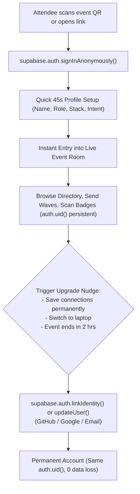

# In-Depth Product & UX Research: Event Networking Web App (Tech Events)

**Target Product**: In-Person & Hybrid Event Networking Room for Tech Events (Hackathons, Developer Summits, Tech Conferences)  
**Target Platform**: Mobile-First Web Application (React + Vite + Tailwind CSS + Supabase Cloud BaaS)  
**Date**: November 2, 2026  
**Document Status**: Final Research Synthesis & Spec-Kit Input  

---

## Executive Summary & Design Constraints

Tech events (hackathons, developer conferences, summits) present a uniquely demanding environment for networking software:
1. **Extreme Time Poverty & High Distraction**: Attendees are in noisy convention halls or busy hack spaces. They will not download a 120MB native app or fill out a multi-page survey. If time-to-first-value exceeds 60 seconds, **drop-off exceeds 65%**.
2. **The "In-App Browser" Trap**: Most attendees arrive via QR code scan or links in social apps (WeChat, Telegram, Twitter/X, Slack, LinkedIn). These open inside sandboxed in-app WebViews that break native Google OAuth redirects, block external cookie handoffs, and lose context if the user switches apps for a magic link email.
3. **Different Modes of Social Interaction**:
   - *Hackathons*: Goal-driven, complementary skill matching (e.g., Backend Python looking for Frontend React + Designer), team status visibility ("Solo looking for team", "Team has 3/4 slots").
   - *Developer Summits & Tech Conferences*: Affinity & role-driven (e.g., AI/ML researchers meeting ML engineers, founders meeting technical co-founders or angel investors, developers exploring ecosystem tools).
4. **Physicality & Serendipity**: Digital networking must augment, not replace, in-person serendipity. Lightweight digital signals ("Available to chat right now at Table 4", "Wave back to exchange contact info", "Scan QR badge") bridge the gap between staring at a screen and tapping someone on the shoulder.

---

## Part 1: Participant Onboarding Flow & Key Profile Data

### 1.1 Industry Benchmarks & Drop-Off Dynamics

| Platform / Mechanism | Time to Value | Friction Points | Drop-Off Rate | Key UX Takeaway |
| :--- | :--- | :--- | :--- | :--- |
| **Grip / Swapcard (Native App Flow)** | 3 – 5 minutes | App store search/download, event access code, password creation, mandatory 8-step profiling. | **50% – 70%** pre-event drop-off | Forcing app downloads and pre-event registration creates massive resistance. PWA/mobile web with zero download has 3x higher adoption. |
| **Brella (Web-App Matchmaking)** | ~90 seconds | Rigid 3-step intent tagging (Networking goals: "Hiring", "Investing", "Trading"). | **30% – 40%** drop-off | Intent-based matchmaking works, but users drop off when forced to select too many nested categories upfront. |
| **Hackathon Discord/Slack (#introductions)** | 2 – 5 minutes | Freeform copy-paste template, unstructured text, high scrolling fatigue, difficult to search or filter. | **80%** unread / ignored | Unstructured intros lead to information overload. Structured cards with 3-4 searchable facets are far superior. |
| **Luma / Partiful (Modern Social Web)** | < 30 seconds | 1-click RSVP with phone or instant profile claim. | **< 15%** drop-off | Best-in-class benchmark: instant entry, minimal questions, immediate social validation. |

### 1.2 Target Onboarding Time Budget (< 60 Seconds on Mobile)

To achieve **> 85% onboarding completion**, the flow must be decomposed into a 3-step micro-wizard completed in **under 45 seconds**:

```
[ Step 1: Identity & Role ] (~15s)
  ├── Full Name / Display Handle (Auto-focused)
  ├── Role / Headline (One-tap role chip: Frontend, Backend, Fullstack, AI/ML, Mobile, Design, PM, Founder)
  └── Optional Avatar (Initials generated automatically if skipped)

[ Step 2: Tech Stack & Interests ] (~15s)
  ├── Primary Tech Stack / Skills (Select 2-4 interactive pill chips: React, Python, Rust, Go, Supabase, PyTorch...)
  └── Freeform quick tag input (comma-separated or enter)

[ Step 3: Intent & Social Handoff ] (~15s)
  ├── "I am looking for..." (Multi-select pill chips: "Hackathon Team", "Co-Founder", "Job / Hiring", "Brainstorming / Chat")
  └── Contact Link (Single smart input: GitHub handle, Telegram @handle, or LinkedIn URL)

===> LAND IMMEDIATELY IN THE LIVE NETWORKING ROOM (Total elapsed: ~45 seconds)
```

### 1.3 Key Data Fields: Immediate vs. Deferred vs. Progressive

| Priority Stage | Data Field | UX Presentation & Constraints | Why It Matters |
| :--- | :--- | :--- | :--- |
| **Immediate (Mandatory)** | **Display Name** | Text input (max 40 chars) | Identifies the participant on badges and cards. |
| **Immediate (Mandatory)** | **Primary Role** | Single-select role chips (`Frontend`, `Backend`, `Fullstack`, `AI/ML`, `UI/UX`, `Product/Biz`, `DevOps`) | Essential for role-based discovery and complementary matching. |
| **Immediate (Mandatory)** | **Top Skills / Stack** | Multi-select chips (max 4 on onboarding, e.g., `TypeScript`, `Python`, `Next.js`, `Supabase`) | Direct matching criterion for developers. |
| **Immediate (Mandatory)** | **Networking Intent** | Multi-select chips (`Looking for Team`, `Have Idea, Need Devs`, `Looking for Co-founder`, `Open to Chat`, `Hiring / Looking for Work`) | Filters out incompatible objectives immediately. |
| **Immediate (Recommended)** | **Primary Contact Link** | Smart handle input (Telegram `@username`, GitHub username, or LinkedIn URL) | Allows 1-click external connection handoff without building a complex messenger. |
| **Deferred (Post-Entry)** | **Detailed Bio / Pitch** | Short 140-char text ("Building an AI agent for healthcare...") | Prompts user via profile completion badge after first 3 room interactions. |
| **Deferred (Post-Entry)** | **Secondary Socials / Portfolio** | Website URL, Twitter/X, Discord tag | Can be edited in "My Profile" at leisure. |
| **Deferred (Post-Entry)** | **Hackathon Project Idea** | Project title + track selection | Displayed only if intent = "Have Idea, Need Devs". |

### 1.4 Authentication Strategy: Anonymous Auth with Progressive Identity Claiming

#### The Problem with Immediate Mandatory Auth
1. **Magic Link Email**: In an event venue, mobile cellular networks are congested. Waiting 60–120 seconds for an email OTP causes immediate abandonment. Furthermore, opening the email link in iOS Mail/Gmail switches apps; iOS opens the link in Safari, losing the original in-app WebView session.
2. **OAuth (Google / GitHub)**: Embedded WebViews (inside Telegram, WeChat, Slack, Twitter) frequently block Google OAuth due to Google's RFC 8252 anti-phishing WebView security policy (`disallowed_useragent`).

#### The Winning Solution: Supabase Anonymous Auth + Progressive Linking


1. **Phase 1: Instant Entry (Anonymous Auth)**
   - When the user lands on the event URL, the client calls `supabase.auth.signInAnonymously()`.
   - Supabase provisions a real row in `auth.users` with `is_anonymous: true` and issues a valid JWT with a unique `auth.uid()`.
   - The user immediately fills the 3 onboarding steps. The profile row is saved in `public.attendees` keyed by `id = auth.uid()`.
   - **Time to entry: 0 seconds auth wait.**
2. **Phase 2: Full Engagement via RLS**
   - RLS policies permit anonymous authenticated users (`auth.role() = 'authenticated'`) to read public profiles, publish their own profile, send waves, and scan peer QR codes.
3. **Phase 3: Progressive Identity Linking**
   - When the attendee wants to:
     - Bookmark contacts permanently across devices (e.g., transition from mobile to laptop).
     - Export leads/connections to CSV/Email.
     - Access organizer features.
   - The app presents a clean banner: *"Save your connections permanently & sync with laptop"*.
   - The app calls `supabase.auth.linkIdentity({ provider: 'github' })` (or `google`, or `updateUser({ email, password })`).
   - **Crucially, Supabase maintains the exact same `auth.uid()`**. All connections, waves, and profile records remain 100% intact with zero database migration needed.

---

## Part 2: Connecting & Socializing Mechanisms

### 2.1 Participant Discovery & Exploration

Tech event attendees need quick, faceted visual exploration:
1. **Searchable Attendee Directory**:
   - Instant client-side fuzzy search on Name, Role, Company/University, and Stack keywords.
   - Debounced (150ms) to maintain fluid 60fps mobile scrolling.
2. **Multi-Faceted Pill Filters**:
   - **Role Filter**: All, Frontend, Backend, Fullstack, AI/ML, Design, PM, Biz.
   - **Intent Filter**: "Looking for Team", "Looking for Devs", "Available to Chat Now", "Co-Founder Wanted".
   - **Skill Tags**: Quick horizontal scroll of the most popular event tags (e.g., `#Rust`, `#Supabase`, `#PyTorch`, `#Solidity`).
3. **Smart Tag Cloud**:
   - Real-time aggregate count of skills in the room. Clicking a tag immediately filters the directory.

### 2.2 Matchmaking Algorithms & Heuristics for Tech Events

Tech events require three distinct matching heuristics depending on the event track:

#### Algorithm A: Complementary Matching (Hackathon Team Formation)
Hackathon teams fail when they have four backend engineers and no frontend developer or designer. The algorithm prioritizes **role diversity and skill complementarity** while aligning on **track interest**.

$$\text{MatchScore}(A, B) = w_{\text{role}} \cdot C_{\text{role}}(A, B) + w_{\text{skill}} \cdot C_{\text{skill}}(A, B) + w_{\text{track}} \cdot S_{\text{track}}(A, B)$$

Where:
- $C_{\text{role}}(A, B)$: **Role Complementarity Score** (1.0 if different functional roles like Frontend + Backend or Dev + UI/UX; 0.2 if identical roles).
- $C_{\text{skill}}(A, B)$: **Jaccard Inverted Skill Distance** ($1 - \frac{|Skills_A \cap Skills_B|}{|Skills_A \cup Skills_B|}$) ensuring non-redundant toolsets.
- $S_{\text{track}}(A, B)$: **Track/Topic Alignment** ($\frac{|Tracks_A \cap Tracks_B|}{|Tracks_A \cup Tracks_B|}$) ensuring both want to build in the same domain (e.g., AI Agent track, FinTech track).
- Default weights: $w_{\text{role}} = 0.45, w_{\text{skill}} = 0.30, w_{\text{track}} = 0.25$.

#### Algorithm B: Cross-Discipline Matching (Developer Summits & Conferences)
For tech conferences and founder summits:
- **Pairing Patterns**:
  - Founder / PM $\longleftrightarrow$ Senior Fullstack / Tech Lead
  - Enterprise Sponsor / Recruiter $\longleftrightarrow$ Experienced Engineer
  - Investor / Angel $\longleftrightarrow$ Pre-seed Founder / Hackathon Winner
- Rule-based pairing score gives maximum weight (+50 points) when User A's `seeking` matches User B's `offering`.

#### Algorithm C: Domain Affinity Matching (Tech Specialists)
- Deep specialists (e.g. AI Researchers, Rust Systems Engineers, Smart Contract Auditors) often want to talk shop with peers in their niche.
- **Affinity Score**: Cosine similarity over skill vector + shared deep tags:
  $$\text{AffinityScore}(A, B) = \frac{\vec{A} \cdot \vec{B}}{\|\vec{A}\| \|\vec{B}\|}$$

### 2.3 Contact Initiation & Social Handshake

How should participants initiate contact? We evaluated four mechanisms:

| Mechanism | UX Friction | Social Awkwardness / Spam Risk | Implementation Complexity | Recommendation |
| :--- | :--- | :--- | :--- | :--- |
| **Direct 1-Click Bookmark** | Zero | Low (private bookmark, other user doesn't know) | Very Low | **Adopt (P1)**: Attendee can bookmark profiles into "Saved Contacts" for personal note-taking. |
| **Mutual "Wave / Handshake"** | Low (1-tap wave) | Low (asymmetric wave triggers notification; contact details only unlocked if recipient waves back) | Medium (Supabase Realtime Broadcast + DB table) | **Adopt (P1 Core)**: Prevents inbox flooding. A sends wave $\rightarrow$ B receives non-intrusive banner $\rightarrow$ B waves back $\rightarrow$ **Mutual Match** celebration modal with Telegram/GitHub/LinkedIn reveal. |
| **QR-to-QR Badge Exchange** | Zero (In-person phone scan) | None (physical consent is explicit) | Low (HTML5 QR Scanner component + dynamic attendee QR code) | **Adopt (P1 Core)**: When two people stand together, User A shows their badge QR; User B scans with app camera. Instantly logs a bidirectional verified connection. |
| **Full In-App Chat Messenger** | High | High (trolls, unread messages, notification fatigue, users check WhatsApp/Telegram anyway) | High (message read receipts, websockets, moderation, media storage) | **Reject for MVP / Defer**: Tech attendees overwhelmingly prefer jumping to Telegram, GitHub, or LinkedIn once introduced. |

#### Recommended Social Model: "Wave $\rightarrow$ Mutual Match $\rightarrow$ External Handoff"
1. **The Wave**: User A taps "Wave 👋" on User B's profile.
2. **Real-Time Notification**: User B sees a toast notification: *"Sharukh waved at you!"*.
3. **The Reciprocal Wave**: If User B taps "Wave Back 👋", both users get a confetti celebration: *"You connected with Sharukh!"*.
4. **Handoff**: The card immediately displays 1-click action buttons: `Open in Telegram`, `View GitHub Profile`, `Connect on LinkedIn`.

### 2.4 In-Person Real-Time Presence & Spatial Context

Online-only networking apps fail at in-person events because you don't know who is actually in the room versus back at the hotel.
1. **"Available to Chat Right Now" (Live Status)**:
   - Prominent toggle on attendee's header: 🟢 *Available to Chat* / ⚪ *In a Session / Busy*.
   - **Auto-Expiration**: To prevent stale statuses, the toggle automatically expires after **60 minutes** unless renewed with 1 tap.
2. **Physical Zone / Micro-Location Tag**:
   - Lightweight dropdown or chip selector:
     - 📍 *Hacker Hall - Table [number]*
     - 📍 *Main Stage / Keynote*
     - 📍 *Workshop Room A / B*
     - 📍 *Coffee & Networking Lounge*
   - Displays as a micro-badge on the participant card: `📍 Table 14 • 🟢 Available`.
3. **Supabase Realtime Presence Channel**:
   - Leverage `supabase.channel('room:presence')` with the client tracking `user_id`, `status`, and `zone`.
   - Ephemeral presence updates require **zero PostgreSQL disk writes**, providing extreme scalability for 1,000+ simultaneous attendees.

---

## Part 3: Organizer Event Dashboard & Insights

Organizers need real-time situational awareness during the event and actionable post-event reports for sponsors.

### 3.1 Critical Organizer Visualizations & Metrics

```
+---------------------------------------------------------------------------------------+
|  EVENT PULSE: AI & Web3 Hackathon 2026 (Live: 342 Checked In / 410 Registered)         |
+---------------------------------------------------------------------------------------+
| [ ACTIVE ATTENDEES ]      [ MUTUAL CONNECTIONS ]      [ TEAMED HACKERS ]              |
|   218 Online Now (64%)      684 Total Handshakes        184 Formed (68 Solo Looking)  |
+---------------------------------------------------------------------------------------+
| [ ROLE BREAKDOWN (Donut) ]          | [ POPULAR SKILL MATRIX (Tag Cloud) ]           |
|  - Fullstack:  38% (130)            |  #Python (182)   #Next.js (144)  #PyTorch (98) |
|  - Backend:    26% (89)             |  #Supabase (92)  #Rust (64)      #Tailwind (61)|
|  - AI / ML:    18% (62)             |  #Solidity (43)  #Figma (38)     #Go (31)      |
|  - UI / UX:    10% (34)             +-------------------------------------------------+
|  - Biz / PM:    8% (27)             | [ INTENT DISTRIBUTION (Horizontal Bar) ]        |
|                                     |  Looking for Teammates  [=================] 52% |
|                                     |  Open to Chat / Learn   [============]     31% |
|                                     |  Looking to Hire        [====]              9% |
|                                     |  Seeking Co-Founder     [===]               8% |
+-------------------------------------+-------------------------------------------------+
| [ REAL-TIME ACTIVITY VELOCITY (Time Series) ]                                         |
|  Handshakes & Waves / 15-min intervals (Spikes at 10:00 AM kickoff & 1:00 PM lunch)   |
+---------------------------------------------------------------------------------------+
```

1. **Role Breakdown Donut Chart**: Reveals skill imbalances immediately (e.g., if there are 120 backend devs but only 15 designers, organizers can announce team formation assistance).
2. **Skill Matrix / Word Cloud**: Highlights dominant languages and frameworks, providing direct ROI data for event sponsors (e.g., Supabase, OpenAI, AWS).
3. **Intent Distribution**: Tracks whether attendees are primarily hacking, job hunting, or socializing.
4. **Hackathon Team Liquidity Ratio**: Solo vs. Teamed ratio. If solo ratio exceeds 40% two hours into the hackathon, organizers know to trigger an in-person mixer.
5. **Connection Density Index**: Total successful mutual waves divided by total active attendees. Measures overall networking vitality.

### 3.2 Administrative & Moderation Controls

1. **Live Attendee Roster**:
   - Real-time tabular view with quick search, role filters, presence status, and reported flag indicators.
   - 1-click actions: View Details, Revoke Access, Re-send Magic Link, Assign Role (Attendee, Mentor, Judge, Organizer).
2. **Live Room Announcements (Pinned Banner)**:
   - Organizers can type a broadcast announcement (e.g., *"Lunch is served in Hall B!"* or *"Hacking submissions close in 30 minutes!"*).
   - Instant push to all active mobile web clients via Supabase Realtime Broadcast. Appears as a sticky banner at the top of every attendee screen.
3. **Moderation & Safety Toolkit (Zero Tolerance)**:
   - **User Reporting**: Attendees can tap "Report Profile" on any user card (Harassment, Inappropriate Content, Spam).
   - **Auto-Quarantine**: 3 reports automatically hide the profile pending organizer review.
   - **Organizer Kick / Ban**: Instantly revokes session token, sets `is_banned = true` in PostgreSQL, and removes profile from public directory via RLS.
4. **Attendee Data Export**:
   - 1-click export to sanitized CSV/JSON (Name, Role, Primary Skills, Contact Handles, Timestamp).
   - Allows GDPR/privacy compliant export with opt-in flags for sponsor recruiting.

---

## Part 4: Synthesis into Spec-Kit Specification Blueprint

This section provides the exact specification structure ready to be compiled into `.specify` specs and executed.

### 4.1 Prioritized User Stories

#### Story 1: Instant Anonymous Mobile Onboarding & Directory Discovery (Priority: P1)
**Description**: As a hackathon/conference attendee scanning a QR code at registration, I want to create my profile and access the live networking directory within 45 seconds without mandatory password setup or app store downloads, so that I can immediately start discovering people to meet.  
**Why this priority**: Without sub-60-second onboarding, mobile web attendees drop off and the networking app fails before adoption starts.  
**Independent Test**: Can be verified by scanning the staging URL in a private mobile browser window, completing the 3-step form, and seeing one's profile card live in the attendee directory in < 45 seconds.  
**Acceptance Scenarios**:
1. **Given** an unauthenticated attendee scanning the event QR code, **When** they load the web app, **Then** an anonymous session is silently established via Supabase Anonymous Auth in < 2s with zero blocking modal.
2. **Given** an active anonymous session, **When** the user submits their Display Name, Role chip, 2+ Tech Stack chips, and Networking Intent, **Then** a profile is created in `public.attendees` and the user lands on the live directory.
3. **Given** a directory with 100+ attendees, **When** the user types "Python" or taps the "Looking for Team" pill filter, **Then** the list filters instantly in < 100ms.

#### Story 2: Real-Time Handshake & In-Person Badge Exchange (Priority: P1)
**Description**: As an attendee exploring the room or meeting someone in person, I want to wave at them digitally or scan their personal QR badge, so that we can mutually exchange contact information without tedious manual typing.  
**Why this priority**: Forms the core value proposition of an event networking app—converting an in-person meeting into a verified contact connection.  
**Independent Test**: Can be tested across two independent browser sessions (User A and User B). User A waves to User B; User B receives a real-time toast and waves back; both profiles unlock direct social handles.  
**Acceptance Scenarios**:
1. **Given** User A views User B's card, **When** User A taps "Wave 👋", **Then** a connection record with status `pending` is created and User B receives a Supabase Realtime toast within 500ms.
2. **Given** User B sees the incoming wave toast from User A, **When** User B taps "Wave Back", **Then** the status transitions to `connected`, confetti animation triggers, and both users see Telegram/GitHub/LinkedIn buttons.
3. **Given** two attendees standing next to each other, **When** User B displays their "My Badge QR" and User A scans it with the in-app scanner, **Then** an instant mutual `connected` status is established immediately without waiting for a reciprocal wave.

#### Story 3: Hackathon Complementary Matchmaker (Priority: P2)
**Description**: As a solo developer or team lead at a hackathon, I want the app to suggest complementary teammates (e.g., matching my backend skills with an available frontend dev or UI/UX designer), so that I can assemble a winning hackathon team fast.  
**Why this priority**: Hackathons have strict deadlines for team registration; automated complementary matching solves the biggest pain point for solo hackers.  
**Independent Test**: Seed 10 attendees with diverse roles. View the "Recommended Teammates" tab and verify that a Backend dev gets recommended Frontend and UI/UX designers with matching track interests first.  
**Acceptance Scenarios**:
1. **Given** a user logged in as "Backend / Python", **When** they switch to the "Matches" tab, **Then** the app executes the complementarity scoring algorithm and displays profiles with high role complementarity and track alignment at the top.
2. **Given** a user who has joined a full team of 4, **When** their team status is updated to "Team Full", **Then** their profile badge changes to "Teamed" and they are deprioritized from the solo hackathon matchmaking pool.

#### Story 4: Live In-Person Presence & Micro-Location (Priority: P2)
**Description**: As an attendee in a large venue, I want to broadcast whether I am available to chat right now and where I am seated, so that other attendees can easily approach me in person.  
**Why this priority**: Transforms an abstract online directory into an actionable physical navigation tool.  
**Independent Test**: Toggle "Available to Chat" and select "Table 8". Open a second client and verify the attendee card immediately reflects the green pulse and location tag via Supabase Realtime Presence.  
**Acceptance Scenarios**:
1. **Given** an attendee in the app, **When** they toggle "Available to Chat" on, **Then** their presence state updates across all connected clients in real time and a 60-minute countdown timer begins.
2. **Given** the 60-minute presence timer elapses without user renewal, **When** the timer hits zero, **Then** the status automatically resets to "Away / In Session" without requiring manual action.

#### Story 5: Organizer Live Command Center & Insights (Priority: P2)
**Description**: As an event organizer, I want a live analytics dashboard showing attendee role distributions, top skill clusters, handshake volume, and an announcement broadcast tool, so that I can steer the event and communicate with all participants.  
**Why this priority**: Gives organizers essential event visibility and emergency broadcast capabilities.  
**Independent Test**: Access `/admin` with organizer credentials, view dynamic charts updating in real time as test attendees join, and publish a test announcement banner that appears instantly on mobile clients.  
**Acceptance Scenarios**:
1. **Given** an authenticated organizer, **When** they load `/admin`, **Then** they see responsive charts for Role Breakdown, Top Skills, Intent Distribution, and Total Connections.
2. **Given** an organizer enters an announcement text and clicks "Broadcast", **Then** a sticky banner appears on all active attendee mobile screens within 1 second.
3. **Given** an attendee reported for inappropriate behavior, **When** the organizer clicks "Remove Attendee", **Then** the user's session is invalidated and their profile is hidden from the directory immediately.

#### Story 6: Progressive Account Upgrade & Permanent Lead Export (Priority: P3)
**Description**: As an attendee who started anonymously, I want to link my permanent GitHub or Google account, so that I can access my saved connections on my laptop after the event and export my contact list.  
**Why this priority**: Ensures long-term user retention and post-event value without adding friction to day-one onboarding.  
**Independent Test**: Create an anonymous profile, bookmark 3 contacts, execute `linkIdentity` with GitHub/Email, log out, log in on another device/browser with those permanent credentials, and verify all 3 contacts remain intact.  
**Acceptance Scenarios**:
1. **Given** an anonymous user with 5 connections, **When** they click "Sync Account" and authenticate via GitHub OAuth or Magic Link, **Then** their `auth.users` row is updated, preserving the same `id`, and their connections remain intact.
2. **Given** an upgraded user, **When** they click "Export Connections", **Then** a sanitized CSV file containing all their mutual matches' names, roles, and contact links is downloaded.

---

### 4.2 Key Entities & Database Schema Architecture (Supabase Cloud)

```sql
-- Core Attendees Profile Table
create table public.attendees (
  id uuid references auth.users(id) on delete cascade primary key,
  event_id text not null default 'default-event',
  display_name text not null check (char_length(display_name) >= 2 and char_length(display_name) <= 50),
  role text not null, -- 'Frontend', 'Backend', 'Fullstack', 'AI/ML', 'Mobile', 'Design', 'Product', 'Founder'
  headline text,
  bio text check (char_length(bio) <= 280),
  skills text[] not null default '{}',
  intent text[] not null default '{}', -- 'Looking for Team', 'Need Devs', 'Co-Founder', 'Open to Chat', 'Hiring'
  contact_handle text, -- '@telegram_user', 'github.com/user', 'linkedin.com/in/user'
  avatar_url text,
  is_available_to_chat boolean not null default false,
  available_until timestamptz,
  current_zone text, -- 'Main Stage', 'Hacker Table 1-20', 'Workshop A', 'Lounge'
  is_banned boolean not null default false,
  created_at timestamptz not null default now(),
  updated_at timestamptz not null default now()
);

-- Connections & Handshakes Table
create table public.connections (
  id uuid primary key default gen_random_uuid(),
  event_id text not null default 'default-event',
  requester_id uuid not null references public.attendees(id) on delete cascade,
  recipient_id uuid not null references public.attendees(id) on delete cascade,
  status text not null check (status in ('pending', 'connected', 'ignored')),
  connection_type text not null check (connection_type in ('wave', 'qr_scan')),
  created_at timestamptz not null default now(),
  updated_at timestamptz not null default now(),
  unique (requester_id, recipient_id)
);

-- Pinned Organizer Announcements Table
create table public.announcements (
  id uuid primary key default gen_random_uuid(),
  event_id text not null default 'default-event',
  author_id uuid not null references auth.users(id),
  title text not null,
  message text not null,
  is_pinned boolean not null default true,
  created_at timestamptz not null default now(),
  expires_at timestamptz
);

-- Row Level Security (RLS) Baseline
alter table public.attendees enable row level security;
alter table public.connections enable row level security;
alter table public.announcements enable row level security;

-- Attendees RLS: Anyone authenticated (including anonymous) can read unbanned attendees
create policy "Public attendees directory viewable" on public.attendees
  for select using (auth.role() = 'authenticated' and is_banned = false);

-- Attendees RLS: Users can update only their own profile
create policy "Users can update own profile" on public.attendees
  for update using (auth.uid() = id);

-- Attendees RLS: Users can insert own profile
create policy "Users can insert own profile" on public.attendees
  for insert with check (auth.uid() = id);

-- Connections RLS: Users can see connections involving them
create policy "Users see own connections" on public.connections
  for select using (auth.uid() = requester_id or auth.uid() = recipient_id);

-- Connections RLS: Users can send a wave / scan
create policy "Users can create connection requests" on public.connections
  for insert with check (auth.uid() = requester_id);

-- Connections RLS: Recipient can update status to 'connected'
create policy "Recipients can respond to connections" on public.connections
  for update using (auth.uid() = recipient_id);

-- Announcements RLS: Read by everyone authenticated
create policy "Announcements viewable by attendees" on public.announcements
  for select using (auth.role() = 'authenticated');
```

---

### 4.3 Measurable Success Criteria

- **SC-001 (Time-to-Entry)**: 90% of first-time mobile web attendees complete onboarding and view the live room in **under 45 seconds** (measured via client analytics timestamp from route mount to directory mount).
- **SC-002 (Onboarding Completion Rate)**: Greater than **85%** of attendees who scan the event QR code complete their profile and enter the room (compared to ~35% on traditional native event apps).
- **SC-003 (Search & Filter Latency)**: Directory search and tag filtering execute client-side in **under 50 milliseconds** with 500 loaded profiles on a standard mobile device.
- **SC-004 (Real-Time Handshake Latency)**: When User A waves or scans User B's QR code, User B's device displays the incoming notification within **< 500 milliseconds** via Supabase Realtime.
- **SC-005 (Mobile Responsiveness & Zero Horizontal Scroll)**: 100% compliant with minimum viewport width 320px up to 4K displays; all tap targets exceed **44x44px** per WCAG 2.1 AA.
- **SC-006 (Zero Credential Leakage)**: Strictly zero service role keys exposed in browser bundles; 100% of data queries protected by PostgreSQL Row Level Security.
- **SC-007 (Network Resilience)**: In congested event WiFi conditions, profile data is cached in `localStorage` / IndexedDB so directory browsing continues seamlessly even during transient disconnects.

---

## Tradeoff & Decision Matrix Summary

| Architectural Decision | Chosen Strategy | Alternative Rejected | Rationale |
| :--- | :--- | :--- | :--- |
| **Initial Authentication** | **Supabase Anonymous Auth** with progressive OAuth linking | Mandatory Magic Link or Google OAuth upfront | Magic links fail in mobile WebViews and suffer from venue network latency; Google OAuth is blocked inside in-app browsers. Anonymous auth gives instant 0-second entry with zero data loss on later upgrade. |
| **Messaging / Contact Handoff** | **Mutual Wave $\rightarrow$ External Links (Telegram, GitHub, LinkedIn)** | Full In-App Chat Messenger | Building an in-app chat creates massive UX bloat, moderation nightmares, and push notification hurdles on mobile web (iOS Web Push requires PWA home screen add). Developers prefer continuing conversations on Telegram or GitHub. |
| **Matchmaking Computation** | **Deterministic Role & Skill Complementarity Algorithm** | Complex ML embedding pipeline or external AI service | A lightweight mathematical complementarity heuristic (role diversity + skill inverse overlap + track alignment) runs synchronously in < 15ms, handles cold-start immediately, and requires zero external API cost or latency. |
| **Real-Time Presence** | **Supabase Realtime Presence Channels with 60m Auto-Timeout** | Polling PostgreSQL database rows | Direct DB polling creates excessive database load at 500+ attendees. Ephemeral presence channels run purely in memory over WebSockets, guaranteeing instant updates with zero database wear. |
| **Venue In-Person Exchange** | **Dual Option: Mutual Digital Wave + Physical QR Badge Scan** | Bluetooth BLE Beacons or GPS Geofencing | BLE and GPS require native app permissions that mobile browsers cannot access reliably, and indoor GPS accuracy is abysmal (+/- 20 meters). QR scans and digital waves work 100% reliably in any browser. |
| **Organizer Room Creation** | **Client-Held Creator Token / Open Route** | Mandatory Email/Password Registration Wall | Minimizes demo friction for the 1-hour build event while enabling organizers to configure rooms and access admin command center immediately. |

### Consolidated Architecture Decisions

- **Decision**: Supabase Anonymous Auth (`signInAnonymously()`) for attendees + client creator session for organizers.
  - **Rationale**: Completely bypasses mobile WebView auth blocks, removes password friction, and supports zero-latency onboarding under 45 seconds.
  - **Alternatives considered**: Mandatory email magic links (rejected due to WebView app-switching context loss) and OAuth-only login (rejected due to Google's disallowed user agent blocks in Telegram/WeChat).

- **Decision**: Deterministic rule-based matchmaking (Complementary Role & Intent pairing).
  - **Rationale**: Immediate execution (< 15ms), zero cold-start delay, 100% predictable for live demos, and fits within 1-hour build event constraints.
  - **Alternatives considered**: OpenAI vector embeddings + pgvector (deferred to future scope to prevent API rate limits and build timeouts).

- **Decision**: Mutual Wave + In-Person QR Badge Scan with direct external handoff (Telegram, LinkedIn, GitHub).
  - **Rationale**: Prevents inbox spam, eliminates in-app chat infrastructure and content moderation overhead, and aligns with tech conference attendee habits.
  - **Alternatives considered**: Custom in-app real-time chat (rejected due to message history storage, notification handling, and time constraints).

- **Decision**: Supabase Realtime Channels (Broadcast & Presence) for waves, presence, and announcements.
  - **Rationale**: Offloads high-frequency ephemeral updates to WebSocket memory channels with zero disk write latency, backed by PostgreSQL tables for permanent connection state.
  - **Alternatives considered**: HTTP polling (rejected due to battery drain and latency) and WebRTC mesh (rejected due to mobile browser NAT traversal instability).
